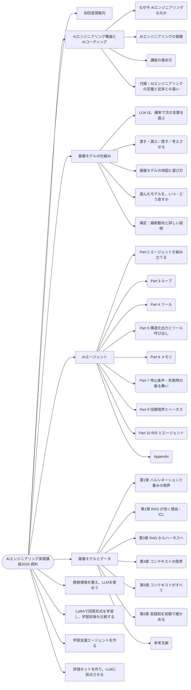

# RAG データ グラフ (graph.json)

`data/rag_data/graph.json` を Mermaid で可視化したもの。ノード 545（collection 1, document 9, page 438, section 25, term 72）、エッジ 2123（contains 472, mentions 1081, next_page 429, related_term 141）。
全体を1枚に描くと読めないため、3つのビューに分けている。

## 1. 構造（コレクション → 文書 → セクション）

ページ数: orientation: 40, lec01-main: 73, lec02-main: 70, lec03-main: 71, lec05-main: 79, lec01-exercise: 25, lec02-exercise: 31, lec03-exercise: 26, lec04-exercise: 23

## 2. 用語どうしの関連（related_term）

141 本のエッジ、65 用語（関連を持つ用語のみ）。

```mermaid
flowchart LR
  term_adk["ADK（Agent Development Kit）"]
  term_agent_loop["エージェントループ"]
  term_agreement_rate["一致率"]
  term_ai_agent["AIエージェント"]
  term_ai_engineering["AIエンジニアリング"]
  term_answer_md["answer.md"]
  term_api["API"]
  term_api_key["APIキー"]
  term_branch["ブランチ"]
  term_code_completion["コード補完"]
  term_codespaces["GitHub Codespaces"]
  term_codespaces_secret["Codespaces secret"]
  term_coding_agent["コーディングエージェント"]
  term_context_window["コンテキストウィンドウ"]
  term_default_model["既定モデル"]
  term_devcontainer["devcontainer"]
  term_edge_case["エッジケース"]
  term_environment_variable["環境変数"]
  term_epoch["エポック"]
  term_evaluation_dataset["評価セット"]
  term_evaluation_loop["評価と改善のサイクル"]
  term_external_tool["外部ツール"]
  term_fetch_server["fetchサーバー"]
  term_fine_tuning["ファインチューニング"]
  term_fork["fork"]
  term_github_copilot["GitHub Copilot"]
  term_guardrail["ガードレール"]
  term_hallucination["ハルシネーション"]
  term_harness["ハーネス"]
  term_homework_levels["宿題の3レベル"]
  term_huggingface_hub["Hugging Face Hub"]
  term_human_in_the_loop["Human-in-the-loop"]
  term_learning_rate["学習率"]
  term_lec_start_tag["lecNN-start タグ"]
  term_llm["LLM（大規模言語モデル）"]
  term_llm_as_a_judge["LLM-as-a-Judge"]
  term_lora["LoRA"]
  term_lora_rank["ランク（LoRAのr）"]
  term_mcp["MCP（Model Context Protocol）"]
  term_mcp_client["MCPクライアント"]
  term_mcp_config["mcpServers設定"]
  term_mcp_server["MCPサーバー"]
  term_mcp_transport["トランスポート（stdio・Streamable HTTP）"]
  term_needs_review["要確認"]
  term_overfitting["過学習"]
  term_peft["PEFT"]
  term_pi["Pi"]
  term_position_bias["位置バイアス"]
  term_pretraining["事前学習"]
  term_prompt["プロンプト"]
  term_pull_request["プルリクエスト（PR）"]
  term_pydantic_ai["Pydantic AI"]
  term_qlora["QLoRA"]
  term_quantization["量子化"]
  term_rate_limit["レート制限"]
  term_rubric["ルーブリック"]
  term_sft["教師ありファインチューニング（SFT）"]
  term_structured_output["構造化出力"]
  term_system_prompt["システムプロンプト"]
  term_temperature["temperature"]
  term_test_model["TestModel"]
  term_token["トークン"]
  term_tool["ツール（Tool use / Function calling）"]
  term_tool_description["ツールの説明文"]
  term_tool_namespace["ツールの名前空間"]
  term_adk --- term_ai_agent
  term_adk --- term_pydantic_ai
  term_agent_loop --- term_ai_agent
  term_agent_loop --- term_rate_limit
  term_agent_loop --- term_tool
  term_agreement_rate --- term_llm_as_a_judge
  term_agreement_rate --- term_rubric
  term_ai_agent --- term_agent_loop
  term_ai_agent --- term_harness
  term_ai_agent --- term_tool
  term_ai_engineering --- term_evaluation_loop
  term_ai_engineering --- term_llm
  term_answer_md --- term_homework_levels
  term_answer_md --- term_pull_request
  term_api --- term_api_key
  term_api --- term_rate_limit
  term_api_key --- term_codespaces_secret
  term_api_key --- term_environment_variable
  term_branch --- term_fork
  term_branch --- term_pull_request
  term_code_completion --- term_github_copilot
  term_codespaces --- term_codespaces_secret
  term_codespaces --- term_devcontainer
  term_codespaces_secret --- term_api_key
  term_codespaces_secret --- term_codespaces
  term_codespaces_secret --- term_environment_variable
  term_coding_agent --- term_ai_agent
  term_coding_agent --- term_harness
  term_context_window --- term_agent_loop
  term_context_window --- term_token
  term_default_model --- term_api_key
  term_default_model --- term_rate_limit
  term_devcontainer --- term_codespaces
  term_edge_case --- term_evaluation_dataset
  term_environment_variable --- term_api_key
  term_environment_variable --- term_codespaces_secret
  term_epoch --- term_learning_rate
  term_epoch --- term_overfitting
  term_evaluation_dataset --- term_edge_case
  term_evaluation_dataset --- term_llm_as_a_judge
  term_evaluation_dataset --- term_rubric
  term_evaluation_loop --- term_ai_engineering
  term_evaluation_loop --- term_hallucination
  term_external_tool --- term_mcp
  term_external_tool --- term_mcp_server
  term_external_tool --- term_tool
  term_fetch_server --- term_external_tool
  term_fetch_server --- term_guardrail
  term_fetch_server --- term_mcp_server
  term_fine_tuning --- term_lora
  term_fine_tuning --- term_peft
  term_fine_tuning --- term_sft
  term_fork --- term_branch
  term_fork --- term_pull_request
  term_github_copilot --- term_code_completion
  term_github_copilot --- term_coding_agent
  term_guardrail --- term_human_in_the_loop
  term_guardrail --- term_system_prompt
  term_hallucination --- term_evaluation_loop
  term_hallucination --- term_tool
  term_harness --- term_coding_agent
  term_harness --- term_pi
  term_homework_levels --- term_answer_md
  term_huggingface_hub --- term_lora
  term_huggingface_hub --- term_pretraining
  term_human_in_the_loop --- term_guardrail
  term_human_in_the_loop --- term_tool
  term_learning_rate --- term_epoch
  term_learning_rate --- term_overfitting
  term_lec_start_tag --- term_branch
  term_llm --- term_pretraining
  term_llm --- term_prompt
  term_llm --- term_token
  term_llm_as_a_judge --- term_agreement_rate
  term_llm_as_a_judge --- term_position_bias
  term_llm_as_a_judge --- term_rubric
  term_llm_as_a_judge --- term_structured_output
  term_lora --- term_lora_rank
  term_lora --- term_peft
  term_lora --- term_qlora
  term_lora_rank --- term_lora
  term_mcp --- term_ai_agent
  term_mcp --- term_mcp_client
  term_mcp --- term_mcp_server
  term_mcp --- term_tool
  term_mcp_client --- term_mcp
  term_mcp_client --- term_mcp_config
  term_mcp_client --- term_mcp_server
  term_mcp_config --- term_mcp_client
  term_mcp_config --- term_tool_namespace
  term_mcp_server --- term_fetch_server
  term_mcp_server --- term_mcp
  term_mcp_server --- term_mcp_client
  term_mcp_server --- term_mcp_transport
  term_mcp_transport --- term_mcp_client
  term_mcp_transport --- term_mcp_server
  term_needs_review --- term_llm_as_a_judge
  term_needs_review --- term_rubric
  term_overfitting --- term_epoch
  term_overfitting --- term_evaluation_loop
  term_peft --- term_fine_tuning
  term_peft --- term_lora
  term_pi --- term_coding_agent
  term_pi --- term_harness
  term_position_bias --- term_llm_as_a_judge
  term_pretraining --- term_fine_tuning
  term_pretraining --- term_llm
  term_prompt --- term_llm
  term_prompt --- term_system_prompt
  term_pull_request --- term_answer_md
  term_pull_request --- term_branch
  term_pydantic_ai --- term_adk
  term_pydantic_ai --- term_structured_output
  term_pydantic_ai --- term_test_model
  term_qlora --- term_lora
  term_qlora --- term_quantization
  term_quantization --- term_qlora
  term_rate_limit --- term_agent_loop
  term_rate_limit --- term_api
  term_rate_limit --- term_default_model
  term_rubric --- term_evaluation_dataset
  term_rubric --- term_llm_as_a_judge
  term_rubric --- term_needs_review
  term_sft --- term_fine_tuning
  term_sft --- term_lora
  term_structured_output --- term_pydantic_ai
  term_system_prompt --- term_guardrail
  term_system_prompt --- term_prompt
  term_temperature --- term_evaluation_loop
  term_temperature --- term_llm
  term_test_model --- term_pydantic_ai
  term_test_model --- term_rate_limit
  term_token --- term_context_window
  term_token --- term_rate_limit
  term_tool --- term_agent_loop
  term_tool --- term_tool_description
  term_tool_description --- term_pydantic_ai
  term_tool_description --- term_tool
  term_tool_namespace --- term_mcp_config
  term_tool_namespace --- term_rate_limit
  term_tool_namespace --- term_tool_description
```

## 3. 頻出用語 Top15 と文書の言及関係（mentions、ページ数、2以上のみ）

```mermaid
flowchart LR
  lec01_exercise["開発環境を整え、LLMを使おう"]
  lec01_main["AIエンジニアリング概論とAIコーディング"]
  lec02_exercise["LoRAで回答形式を学習し、学習前後を比較する"]
  lec02_main["基盤モデルの仕組み"]
  lec03_exercise["学習支援エージェントを作る"]
  lec03_main["AIエージェント"]
  lec04_exercise["評価セットを作り、LLMに採点させる"]
  lec05_main["基盤モデルとデータ"]
  orientation["初回冒頭案内"]
  term_ai_agent(["AIエージェント"])
  term_tool(["ツール（Tool use / Function calling）"])
  term_llm(["LLM（大規模言語モデル）"])
  term_ai_engineering(["AIエンジニアリング"])
  term_api(["API"])
  term_fine_tuning(["ファインチューニング"])
  term_prompt(["プロンプト"])
  term_rag(["RAG"])
  term_token(["トークン"])
  term_memory(["メモリ"])
  term_harness(["ハーネス"])
  term_codespaces(["GitHub Codespaces"])
  term_system_prompt(["システムプロンプト"])
  term_lora(["LoRA"])
  term_evaluation_dataset(["評価セット"])
  term_ai_agent -- 8 --> lec01_exercise
  term_ai_agent -- 14 --> lec01_main
  term_ai_agent -- 2 --> lec02_exercise
  term_ai_agent -- 7 --> lec02_main
  term_ai_agent -- 17 --> lec03_exercise
  term_ai_agent -- 33 --> lec03_main
  term_ai_agent -- 7 --> lec04_exercise
  term_ai_agent -- 13 --> lec05_main
  term_ai_agent -- 3 --> orientation
  term_ai_engineering -- 32 --> lec01_main
  term_ai_engineering -- 2 --> lec02_main
  term_ai_engineering -- 2 --> lec03_exercise
  term_ai_engineering -- 2 --> lec05_main
  term_ai_engineering -- 11 --> orientation
  term_api -- 11 --> lec01_exercise
  term_api -- 4 --> lec01_main
  term_api -- 3 --> lec02_exercise
  term_api -- 13 --> lec02_main
  term_api -- 3 --> lec03_exercise
  term_api -- 11 --> lec03_main
  term_api -- 2 --> lec04_exercise
  term_api -- 2 --> lec05_main
  term_codespaces -- 9 --> lec01_exercise
  term_codespaces -- 2 --> lec01_main
  term_codespaces -- 2 --> lec02_exercise
  term_codespaces -- 9 --> lec03_exercise
  term_codespaces -- 4 --> lec04_exercise
  term_evaluation_dataset -- 3 --> lec01_main
  term_evaluation_dataset -- 11 --> lec02_main
  term_evaluation_dataset -- 2 --> lec03_main
  term_evaluation_dataset -- 9 --> lec04_exercise
  term_fine_tuning -- 6 --> lec01_main
  term_fine_tuning -- 4 --> lec02_exercise
  term_fine_tuning -- 33 --> lec02_main
  term_fine_tuning -- 7 --> lec05_main
  term_harness -- 18 --> lec03_main
  term_harness -- 2 --> lec04_exercise
  term_harness -- 9 --> lec05_main
  term_llm -- 6 --> lec01_exercise
  term_llm -- 8 --> lec01_main
  term_llm -- 2 --> lec02_exercise
  term_llm -- 22 --> lec02_main
  term_llm -- 5 --> lec03_exercise
  term_llm -- 8 --> lec03_main
  term_llm -- 10 --> lec04_exercise
  term_llm -- 8 --> lec05_main
  term_llm -- 2 --> orientation
  term_lora -- 4 --> lec01_exercise
  term_lora -- 9 --> lec02_exercise
  term_lora -- 6 --> lec02_main
  term_lora -- 4 --> lec03_exercise
  term_lora -- 2 --> lec04_exercise
  term_memory -- 2 --> lec01_main
  term_memory -- 3 --> lec02_exercise
  term_memory -- 14 --> lec03_main
  term_memory -- 11 --> lec05_main
  term_prompt -- 8 --> lec01_main
  term_prompt -- 12 --> lec02_main
  term_prompt -- 3 --> lec03_exercise
  term_prompt -- 7 --> lec03_main
  term_prompt -- 14 --> lec05_main
  term_rag -- 6 --> lec01_main
  term_rag -- 24 --> lec02_main
  term_rag -- 2 --> lec04_exercise
  term_rag -- 12 --> lec05_main
  term_system_prompt -- 2 --> lec01_main
  term_system_prompt -- 7 --> lec03_exercise
  term_system_prompt -- 6 --> lec03_main
  term_system_prompt -- 5 --> lec04_exercise
  term_system_prompt -- 4 --> lec05_main
  term_token -- 5 --> lec01_exercise
  term_token -- 4 --> lec02_exercise
  term_token -- 17 --> lec02_main
  term_token -- 8 --> lec03_main
  term_token -- 9 --> lec05_main
  term_tool -- 4 --> lec01_exercise
  term_tool -- 10 --> lec01_main
  term_tool -- 2 --> lec02_main
  term_tool -- 16 --> lec03_exercise
  term_tool -- 33 --> lec03_main
  term_tool -- 4 --> lec04_exercise
  term_tool -- 16 --> lec05_main
  term_tool -- 5 --> orientation
```

